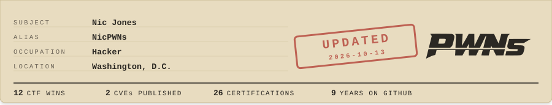

<!-- Nice — you opened the file. Poking around the source? You'll fit right in. Say hi: nic@nicpjones.com -->

Information security professional by day, security researcher and CTF competitor by night, and a SANS.edu MSISE candidate in between. Find me on [LinkedIn](https://linkedin.com/in/NicPJones), [Credly](https://www.credly.com/users/nicpjones/badges), and [Hack The Box](https://app.hackthebox.com/users/72382).

<!-- latest starts -->
| 🏆 Latest win | 🔓 Latest CVE | 📜 Latest cert |
| :-- | :-- | :-- |
| [huntr "Inside Job" AI Red Teaming Challenge](https://huntr.com/challenges/3AjanuyEaXoNr6ySHpyo6L/v1/leaderboard) 1st Place Overall · Sep 2026 | [CVE-2026-62183](https://www.cve.org/CVERecord?id=CVE-2026-62183) Apache Syncope: User Self-Service Privilege Escalation · Jul 2026 | [GIAC Penetration Tester (GPEN)](https://www.credly.com/earner/earned/badge/e667ed12-ff73-4be3-a367-4924c2c41679) GIAC · Aug 2026 |
<!-- latest ends -->

This file rebuilds itself nightly from the same <a href="https://gist.github.com/NicPWNs/5489290125ff3707caf8d51cb6cdc8a0">resume.json</a> that powers <a href="https://nicpjones.com">nicpjones.com</a> and my PDF resume. <a href="scripts/build_readme.py">How it works.</a>
